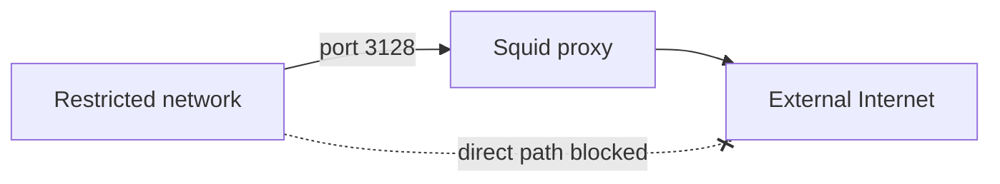

# Squid Genesis Kit

This Genesis kit deploys a single, standalone [Squid caching web proxy](http://www.squid-cache.org/) on the standard port, TCP 3128.

The proxy gives deployments a way to send Internet-bound HTTP and HTTPS traffic out when their own networks have little or no direct outbound access. You deploy it into a DMZ-style network that does have egress, and the deployments inside the restricted network send their requests through it.

That helps in several situations:

- BOSH directors in restricted networks can download stemcells and releases.

- Cloud Foundry can fetch online buildpacks.

- Development environments get controlled Internet access.

- Compliance rules that require filtered Internet traffic have one place to enforce it.

## Architecture



## Quick start

You need Genesis 3.1.0 or later, and you don't need to clone this repository. Create a deployment repo with one of these commands:

```
# a squid-deployments repo on the latest squid kit
genesis init --kit squid

# a squid-deployments repo on a given version of the kit
genesis init --kit squid/1.2.0

# a my-squid-configs repo on the latest squid kit
genesis init --kit squid -d my-squid-configs
```

Then create an environment and deploy it:

```
cd squid-deployments
genesis new my-env
genesis deploy my-env
```

Once it's deployed, `genesis info` prints the proxy's address and the environment variables that point a shell at it:

```
genesis my-env info
```

To check that the proxy works, send a request through it with the `curl` addon:

```
genesis my-env do curl -sI https://www.google.com
```

Finally, point your BOSH and Cloud Foundry deployments at the proxy by adding these parameters to their environment files, and redeploy them:

```
params:
  http_proxy:  http://proxy-ip:3128
  https_proxy: http://proxy-ip:3128
```

## Stemcells

The kit deploys on the `ubuntu-xenial` stemcell with squid 1.1.0 by default. To deploy on `ubuntu-resolute`, turn on the `resolute` feature, which also swaps in squid 2.0.0, a release that builds Squid 7.7. The [manual](MANUAL.md#resolute) explains why the two go together.

## Heads up

When you set `http_proxy` and `https_proxy` in a manifest, you also have to manage `no_proxy`. Otherwise all HTTP and HTTPS traffic goes through the proxy, which is rarely what you want.

For example, a BOSH director's environment file might look like this:

```
params:
  static_ip:   10.10.100.1
  http_proxy:  http://proxy-ip:3128
  https_proxy: http://proxy-ip:3128
```

That sends every HTTP and HTTPS request through the proxy, including the API traffic that should go straight to your IaaS (such as vCenter) and the traffic bound for the local blobstore. The resulting failures are hard to diagnose.

To avoid that, list the director's own addresses, including loopback, in `no_proxy`:

```
params:
  static_ip:   10.10.100.1
  http_proxy:  http://proxy-ip:3128
  https_proxy: http://proxy-ip:3128
  no_proxy:    10.10.100.1,127.0.0.1,localhost
```

Traffic from the director to itself now skips the proxy and connects directly.

On a cloud provider, you should usually add the provider's API endpoints to `no_proxy` as well:

```
# AWS
no_proxy: 10.10.100.1,127.0.0.1,localhost,169.254.169.254,*.amazonaws.com

# GCP
no_proxy: 10.10.100.1,127.0.0.1,localhost,metadata.google.internal,*.googleapis.com

# Azure
no_proxy: 10.10.100.1,127.0.0.1,localhost,169.254.169.254,*.azure.com
```

## Troubleshooting

When you can't connect to the proxy, check that the proxy's address is reachable, that port 3128 is open, and that your security groups or firewall rules allow traffic to it.

When the proxy returns errors, confirm that it's running with `genesis my-env bosh instances`, read its logs with `genesis my-env bosh logs squid/0`, and check that the ACL allows your source address.

When traffic doesn't go through the proxy at all, check that `http_proxy` and `https_proxy` are set in the client's environment. Some applications ignore those variables and need their own proxy settings.

For deeper digging, you can SSH into the proxy VM:

```
genesis my-env bosh ssh squid/0
```

## Learn more

The [manual](MANUAL.md) covers every parameter, the features, the deploy-time checks, and more ACL examples.
